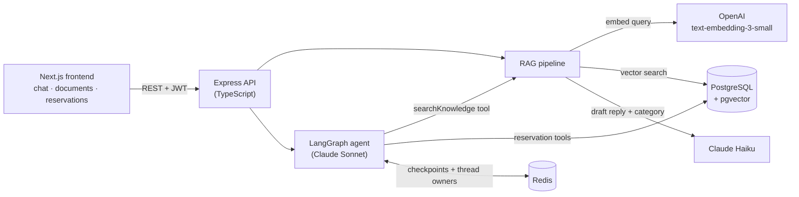

# ClinicDesk AI

An AI front-desk assistant for allied health clinics. Staff upload clinic documents (fees, referral rules, cancellation policy). The assistant then answers patient enquiries from those documents, with sources, and books, changes or cancels appointments through a chat agent that **asks for confirmation before it writes anything**.

**Live demo:** (www.clinicdesk-ai.site)

<!-- TODO: add a short GIF: ask a fees question → book an appointment → "Confirm?" → Approve -->

> Demo project with fictional clinic data. It does not give medical advice, diagnose, or triage.

---

## Features

- **Answers grounded in clinic documents (RAG).** Upload `.txt`, `.md`, `.csv` or `.pdf` files. Text is chunked, embedded and stored in Postgres with pgvector. Each enquiry gets a category, a draft reply, and the source snippets it was based on.
- **Booking agent with human approval.** A LangGraph agent with 7 tools (knowledge search, availability, create / list / get / modify / cancel reservation). Write actions pause the agent and ask the user to approve before anything is saved.
- **Conversations survive restarts.** Agent state is stored in Redis, so a pending "Confirm booking?" still works after a redeploy.
- **Evaluated, not just demoed.** A retrieval and answer eval suite, plus agent behaviour tests (see [Evaluation](#evaluation)).
- **Roles.** Admins manage documents and see all reservations. Patients chat and manage their own bookings.
- **Observability.** Every agent turn is logged with the tools it used and its latency.

## Architecture



**Document upload:** extract text → split into ~500-character chunks with 50-character overlap → embed all chunks in one API call → store them in a pgvector column.

**Enquiry:** embed the question → find the top 5 chunks by cosine similarity → Claude Haiku returns JSON with the category, whether the question can be answered, and a draft reply.

## Design decisions

**Human approval for write actions.** An agent shouldn't book or cancel an appointment from a misread message. Write tools call LangGraph's `interrupt()`, which pauses the run and returns `pending_confirmation` to the UI. A second request (`/api/agent/resume`) continues from exactly where the agent paused, with the user's decision.

**Agent state in Redis, not in memory.** Approval takes two HTTP requests, so the paused agent has to be stored somewhere in between. It started in an in-memory `MemorySaver`, which meant a redeploy between "Confirm?" and "Approve" lost the booking. Checkpoints and conversation ownership now live in Redis with a 1-hour expiry. Along the way this fixed a bug where re-sending the chat history duplicated messages in the saved state every turn.

**Conversations belong to their owner.** Each `conversationId` is tied to the user who started it. Another user can't continue or approve it, even if they know the id.

**Prompt changes driven by evals.** The category classifier was adjusted using failed eval cases, not by guesswork (see below).

**Kept simple on purpose.** One API, one database, no microservices or job queues. The goal is a complete, working product that's easy to read.

## Evaluation

`npm run eval` runs 17 labelled enquiries through the full RAG pipeline and writes a report to `backend/eval-results/`.

| Metric            | What it checks                                   | Result           |
| ----------------- | ------------------------------------------------ | ---------------- |
| Category accuracy | Correct label (Fees, Referral, Cancellation, …)  | **100%** (17/17) |
| Hit rate @5       | The right chunk is in the top 5 results          | **100%**         |
| MRR               | How high the right chunk ranks                   | **1.0**          |
| Fact coverage     | Expected facts appear in the reply               | **96.7%**        |
| Answerability     | Out-of-scope questions are declined, not made up | **100%**         |

Category accuracy was **88%** before the classification prompt was tuned using these results.

Agent behaviour is covered by `src/eval/agent.eval.test.ts`: it asks for missing booking details, pauses before writes, and completes an approved write exactly once.

## Tech stack

| Layer    | Tech                                                                                    |
| -------- | --------------------------------------------------------------------------------------- |
| Frontend | Next.js, React, TypeScript, Tailwind CSS                                                |
| Backend  | Node.js, Express 5, TypeScript                                                          |
| AI       | Claude Sonnet (agent), Claude Haiku (replies), OpenAI embeddings, LangChain / LangGraph |
| Data     | PostgreSQL + pgvector, Prisma, Redis 8                                                  |
| Testing  | Vitest, custom RAG eval harness                                                         |
| Infra    | Docker Compose                                                                          |

## Running locally

Requires Docker, an Anthropic API key and an OpenAI API key.

```bash
git clone https://github.com/Alex-0807/ClinicDesk_AI.git
cd ClinicDesk_AI
cp .env.example .env          # add your API keys and a JWT secret
docker compose up -d --build
```

Create the tables and load the demo clinic documents:

```bash
docker compose exec backend npx prisma migrate deploy
docker compose exec backend npm run db:seed
```

Open http://localhost:3002. The seed creates an admin account; see `backend/prisma/seed.ts`.

| Service     | Port |
| ----------- | ---- |
| Frontend    | 3002 |
| Backend API | 3003 |
| PostgreSQL  | 5433 |
| Redis       | 6380 |

> After adding or upgrading npm packages, rebuild with `docker compose up -d --build --renew-anon-volumes`. `node_modules` lives in its own Docker volume and otherwise keeps the old packages.

### Tests

```bash
cd backend
npm install
npx vitest run src/agent src/utils    # unit tests, no API keys or services needed
npm run eval                          # RAG eval (needs API keys + database)
```

## Project structure

```
backend/
  src/agent/       LangGraph agent, tools, approval flow
  src/services/    embedding, retrieval, generation, reservations
  src/routes/      Express routes (auth, documents, enquiries, reservations, agent)
  src/eval/        eval dataset, metrics, agent behaviour tests
  src/lib/         Prisma and Redis clients
  prisma/          schema, migrations, seed data
frontend/
  src/app/         pages: chat, documents, reservations, admin, rag-pipeline
  src/components/  UI components
```

## Roadmap

- Streaming chat replies
- Page-aware PDF parsing, so sources can cite "Fees.pdf, p.2"
- Hybrid search (full-text + vector) and reranking
- Rate limiting on the agent endpoint
- CI with GitHub Actions
